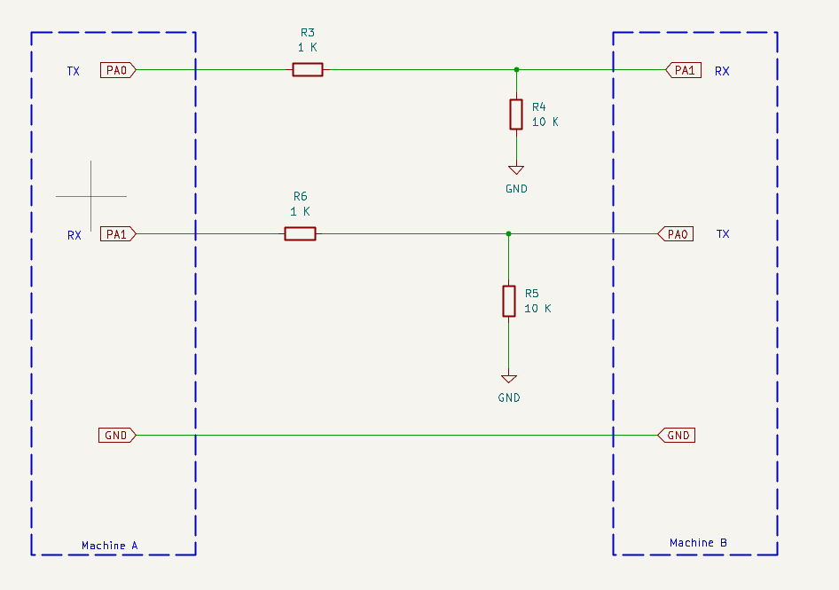

# Beast sync

Synchronise the start of two programs running on two different {Micro/Nano}Beasts.

They're connected via a simple 3 wire interface:



## Build it 

You need [sjasmplus](). Edit the `Makefile` to point to it then type: 

```
make
```

This should generate `SYNC.COM` that you can copy to the machines you want to 
synchronise. It's one binary for nanobeast/microbeast, whether "leader" or
"follower".

## Usage 

If you've got a command you want to run on both machines, prefix it with `sync` and 
some mode flags:

```
SYNC <flags> <prog>[.ext] [args...]
```

Where:

flags (any order, any case, other letters ignored):
  - **M**  MicroBeast  - Z84C20 PIO, port A data 0x10 / control 0x12
  - **N**  NanoBeast   - CPLD, port A data 0x10 / direction 0x11 (always bit mode)
  - **L**  leader      - sends the heartbeat and the START pulse
  - **F**  follower    - echoes RX to TX, fires on the falling edge of START

**\<prog\>** defaults to .COM. Everything after it becomes the program's
command thanail at 0x0080, and the first two words are parsed into the
default FCBs at 0x005C/0x006C, just as the CCP would have done.

Once you've run that on one machine, run the equivalent command on the other 
machine. One machine must be "leader" and the other must be "follower".

*\<prog\>* must exist on both machines, there's no file transfer here. 

Obviously you can use a different *<prog>* on Machine A than Machine B. Their
starts will still be synchronised. 

## Pitfalls 

`sync.com` copies itself into high memory, and runs there as an overlay 
on top of \<prog\>. If \<prog\> is huge, there might not be enough space
left for `sync.com`, in which case it will print an error and bail.

## Example 

On machine A, a MicroBeast:

```
sync ML phaserf.com
```

The MicroBeast is the leader, it will wait for another machine to sync.

On Machine B, a NanoBeast:

```
sync NF phaserf.com
```

The NanoBeast is the follower. It will sync with the master, then both 
should begin playing in unison. The sync handshake takes around 30ms, and the 
latency between the two should be +/- 20 T-states, or about 2us.

It doesn't matter which one starts first: you can start the follower after 
the leader, if you like.
